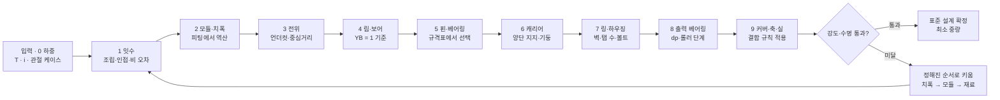

# 마스터플랜 — 유성감속기 구조 결정 알고리즘

2026-11-24 · v0.3 (사이트 마스터플랜·운영 원칙 추가, #73 D7) · 구조 결정 알고리즘은 2026-11-16 초안 v0.2

## 사이트 마스터플랜과 운영 원칙 (2026-11-24 · 논의 이슈 #73 · 결정 D7)

### 설계 흐름 (사용자 정의)
| 단계 | 내용 | 주체 |
| --- | --- | --- |
| 1. 엑셀 검토 | 설계의뢰서(엑셀)의 요구조건으로 AI가 초안 컨셉 작성 | AI |
| 2. 추천 제원 검토 | AI 산정 제원·규격을 사용자가 검토하고 개선 여부 판단 | 사용자 |
| 3. 3D 조작으로 설계 변경 | 3D 화면에서 쉬운 조작으로 설계 개선 (한 화면에서 계산) | 사용자 |
| 4. 검증 | 시험·실측 대비 예측 검증, 결과를 DB에 축적 | 사용자 + AI |

공통 조건: 계산 실수 없음 · 사이트 디자인 스타일 유지 · 비전문가도 조작 가능.

### 운영 원칙
1. 결정권은 사용자에게 있다. Claude·GPT는 의견과 근거를 내고, 서로 동의한 내용은 체크박스로 사용자 결정을 요청한다. 사용자가 체크한 항목만 확정이다. 에이전트 글에는 `[x]`를 쓰지 않는다.
2. 사이트 배포와 마스터플랜 갱신은 매번 사용자에게 묻고, 승인된 뒤에만 병합·배포·갱신한다.
3. 사용자 승인이 필요하면 호출한다(글 맨 위 `🔔 사용자 승인 필요` + 각자의 알림).
4. 의견의 중점: 사이트 신뢰성 확보 · 사용자 편의성 · 계산 오류 추적 · 기능 고도화.
5. 기능 변경·추가는 사용자 승인 없이 하지 않는다. 두 에이전트의 합의는 승인이 아니다.
6. 결정 항목에는 고정 ID(D1, D2-1 …)를 붙이고, 결정 기록과 PR 본문에 같은 ID를 쓴다(D5).

### 분담 (결정 D3)
- Claude: 계산 엔진·판정·테스트, 엑셀 의뢰서와 엑셀 → 설계 변환, 추천 제원, 설계 DB
- GPT: 3D 작업공간·화면 구성·조작성, 브라우저 시험
- 엔진이 결과 객체(`D.provenance`, `R.system`, `pgd-test/1`)를 내보내고 화면은 그 객체만 그린다. 상대 담당 파일은 #73에서 확인받은 뒤 수정한다.

### 확정된 방향 (2026-11-24)
- D1: 오차 0 가정과 ISO 계산 조건 값을 병기하고 적용 조건을 표시한다. ISO 값은 보장 하한이 아니다.
- D2: 핀·캐리어·링 체결·C2 결합·출력 베어링을 종합판정에 포함한다. 검사 상태는 충족 / 미달 / 입력 필요 / 적용 대상 아님. 역산이 검증된 항목만 허용토크 수치에 넣고 포함 범위를 표시한다.
- D4: 의뢰서 한 건으로 1→2→3→4 최소 흐름을 먼저 완성한 뒤 확장한다.

---

## 구조 결정 알고리즘

### 목표

실물·실측 데이터 없이, **필수 입력 3개(정격 토크, 감속비, 관절 케이스)만으로** 2단 중공 유성감속기의 기어·축·베어링·캐리어·하우징 치수를 모두 정하고, 실물에 가까운 강도·수명·성능 판정까지 내는 것. 규칙 상수는 상용 카탈로그 조사 결과로 다시 맞춘다.

- 고정 구조: 링 고정·썬 입력·캐리어 출력, 2단 링 공유, 중공형, 양단 지지 캐리어, 크로스 롤러 출력
- 결정 방식: 크기 결정 → 형상 규칙 → 결합 규칙 → 강도 검증 → 미달이면 정해진 순서로 키움
- 사용자는 어떤 결과든 덮어쓸 수 있고, 덮어쓴 항목은 예외 대장에 사유와 함께 남긴다
- 계산 엔진(`engine.js`)은 그대로 두고, 규칙은 별도 모듈(`rules.js`, 예정)로 엔진의 입력값만 만든다

## 입력

| 구분 | 입력 | 기본값 | 쓰이는 곳 |
| --- | --- | --- | --- |
| 필수 | 정격 출력토크 T (N·m) | — | 모든 크기 결정의 기준 |
| 필수 | 감속비 i | — | 2단 잇수 탐색 (8~40) |
| 필수 | 관절 케이스 (상·하체 × 롤·피치·요) | — | 피크·비상 토크비, 부하 스펙트럼, 수명, 출력 베어링 외부 하중 |
| 선택 | 외경 상한 Dmax (mm) | 제한 없음 | 크기 결정의 상한, 위반 시 재료 상향 |
| 선택 | 중공 지름 dh (mm) | 0.3 × 링 외경 | 입력축·1단 썬 보어 |
| 선택 | 재료·품질 | 질화강 MQ | 허용응력 |
| 선택 | 정밀도 등급 | ISO 1328 5급 | Kv, KHβ, Kγ |
| 선택 | 유성 수 | 3 | 하중 분배, 조립 조건 |
| 선택 | 정격 입력 rpm | 케이스의 관절 속도 × i | 수명 반복수, 윤활 |

## 구조 옵션

구조 결정은 "옵션 선택 → 규칙 적용" 순서다. 아래 옵션이 감속기의 토폴로지와 형상을 정하고, 각 옵션은 계산(강도·수명·강성)이나 형상에 정해진 방식으로 반영된다. 1~19는 사용자 정의 변수, 20~24는 추가 제안이다. 기본값 열은 9:1 2단 중공 감속기(EG-KH-PG-R01) 기준으로 확정할 예정이다.

### 기어·축 연결

| # | 변수 | 선택지 | 계산 반영 | 형상 반영 |
| --- | --- | --- | --- | --- |
| 1 | 링기어 1·2단 공유 | 공유 / 단별 | 공유 시 zr·m·β 동일 → 잇수 탐색 자유도 감소 | 링 1개 / 2개 |
| 2 | 링–하우징 | 일체 / 결합 | 일체면 링 재료 = 하우징 재료 (알루미늄 불가 → 강 하우징) | 부품 수 |
| 3 | 링 결합 방식 (2 = 결합) | 압입 / 볼트+다월핀 / 키 | 토크 전달 검토, 압입 시 면압(Lamé)과 링 수축 → 백래시 감소 | 링 외경 공차, 볼트·핀 구멍 |
| 4 | 2단 캐리어 = 최종 출력축 | 고정 | — | 출력 베어링·플랜지가 2단 캐리어에 결합 |
| 5 | 1단 캐리어 → 2단 썬 결합 | 고정 | — | — |
| 6 | 1단 캐리어–2단 썬 | 일체 / 결합 | 결합 시 2단 썬 보어 → 림 계수 YB | 부품 수 |
| 7 | 그 결합 방식 (6 = 결합) | 스플라인 / 압입 / 키 | 스플라인 유격이 있으면 2단 썬 자리잡음 → 2단 Kγ 감소 | 2단 썬 보어 형상 |
| 8 | 1단 썬–모터축 | 일체 / 결합 | 일체면 썬 보어 없음(또는 중공축) | 입력축 유무 |
| 9 | 그 결합 방식 (8 = 결합) | 키 / 압입·접착 / 클램프 / 스플라인 | 토크 전달 검토, 썬 림 | 보어·키홈·클램프 |

### 회전 지지

| # | 변수 | 선택지 | 계산 반영 | 형상 반영 |
| --- | --- | --- | --- | --- |
| 10 | 1단 썬 지지 베어링 | 없음(모터 베어링 의존) / 1개 / 2개, 위치 | 1단 썬 지지 강성·유격 → 1단 Kγ | 베어링·스페이서 |
| 11 | 1단 캐리어 지지 베어링 | 없음 / 출력측 1개 / 양측 | 2단 썬 지지 강성 → 2단 Kγ. **없음이면 2단 썬은 사실상 플로팅** | 하우징 내부 단차 |
| 12 | 2단 캐리어 지지 베어링 | 메인 출력 베어링 겸용 / 별도 1개 / 별도 2개, 위치 | 2단 캐리어 기울기 → 2단 fsh(KHβ) | 베어링 배치 |
| 13 | 하우징 메인 출력 베어링 위치 | 2단 기어 폭 안 / 2단 출력측 바깥 / 출력 플랜지 쪽 | 외부 모멘트 → 캐리어 기울기 전달 경로 | 전체 길이, 하우징 단면 |

### 축방향 배치

| # | 변수 | 선택지 | 계산 반영 | 형상 반영 |
| --- | --- | --- | --- | --- |
| 14 | 1단 캐리어–2단 캐리어 축방향 간격 | 값 (mm) | — | 링 길이(공유 시), 전체 길이 |
| 19 | 유성 배치 공간 축방향 유격 | 기어 두께 + 유격 (mm) | 와셔·유격 → 핀 지지 스팬(처짐) | 캐리어 판 간격 |

### 캐리어와 유성 베어링

| # | 변수 | 선택지 | 계산 반영 | 형상 반영 |
| --- | --- | --- | --- | --- |
| 15 | 캐리어 구조 | 양단 지지 / 편단 지지 | 핀 보 모델(양단/외팔), 캐리어 와인드업 → fsh | 판 2장+기둥 / 판 1장 |
| 16 | 유성 베어링 방식 | 풀니들(총롤러) / 기성 베어링 | 수명·정격 계산식 선택 | 유성 보어 |
| 17 | 풀니들 제원 (16 = 풀니들) | 니들 지름 Dw, 길이 Lw, 개수 Z | 18의 입력 | 유성 보어 = 핀 지름 + 2Dw |
| 18 | 풀니들 허용하중 | 17로 계산 | 아래 식 | — |

**18. 풀니들 유성 베어링의 정격 계산** (핀이 내륜, 유성 보어가 외륜 역할, 접촉각 0°)

- 피치원 Dpw = 핀 지름 + Dw, 기하 한계 Z ≤ π·Dpw / Dw (총롤러는 원주 틈 0.5~1 Dw를 남김)
- 동정격 (ISO 281, 선접촉):

```math
C_r = b_m\,f_c\,(i\,L_{we})^{7/9}\,Z^{3/4}\,D_{we}^{29/27}
```

   bm = 1.1, fc = Dwe/Dpw에 따른 ISO 281 표 값(보간), i = 열 수, Lwe = 유효 롤러 길이
- 정정격 (ISO 76):

```math
C_{0r} = 44\left(1-\frac{D_{we}}{D_{pw}}\right) i\,Z\,L_{we}\,D_{we}
```

- 궤도면 경도 보정: 핀·유성 보어 경도가 HRC 58 미만이면 경도 계수로 Cr·C0r를 낮춤 (질화 650 HV ≈ HRC 58 경계 → 확인 필요)
- 수명: L10 = (Cr/P)^(10/3) × 10⁶ rev, P = 유성 1개당 반경 하중 (현재 엔진의 핀 하중)
- 총롤러는 케이지가 없어 허용 회전수가 낮다 → 유성 상대 회전수로 별도 확인

### 추가 제안

| # | 변수 | 선택지 | 계산 반영 | 형상 반영 |
| --- | --- | --- | --- | --- |
| 20 | 출력 베어링 형식 | 크로스 롤러 / 앵귤러 2열 / 볼 2개 | 모멘트 강성, 등가하중 식 | 길이·외경 |
| 21 | 중공 여부와 경로 | 없음 / 입력축~출력 관통 | 모든 보어의 하한 | 중공 지름 |
| 22 | 단별 유성 수 | 3 / 4 / 5 | 조립 조건, Kγ | 기둥 수·위치 |
| 23 | 하우징 분할 | 입력 커버 분리 / 출력측 분리 / 양쪽 | — | 볼트 위치, 조립 순서 |
| 24 | 오일 실 위치 | 입력측 / 출력측 / 양쪽 | 실 마찰 손실(효율) | 실 홈 |

## 결정 순서



입력과 하중에서 시작해 기어 → 축·베어링 → 구조물 순으로 정하고, 검증에서 미달이면 정해진 순서로 한 가지를 키운 뒤 1단계부터 다시 돈다.

## 단계별 규칙

각 단계는 앞 단계의 결과만 쓰고, 값이 바뀌면 뒤 단계를 다시 돌린다. 수식의 기호는 사이트 계산 엔진과 같다.

### 0. 하중 정의

- 피크·비상 토크, 부하 스펙트럼, 수명, 출력 베어링 외부 하중(Fr·Fa·M) = 관절 케이스 × T (현재 사이트 규칙 그대로)
- 단별 토크: 2단 썬 = T / i2, 1단 썬 = T / i

### 1. 감속비 분배와 잇수

- 링 공유이므로 zr·모듈·비틀림각은 두 단이 같고, 썬 잇수만 다르다: i = (1 + zr/zs1)(1 + zr/zs2)
- 탐색 조건 (모두 만족): 조립 (zs + zr)/n = 정수, zp = (zr − zs)/2 = 정수, 인접 간섭 없음, zs ≥ 12, 비 오차 ≤ 1 %
- 우선순위: 비 오차 최소 → 헌팅 투스(권장) → zr이 클수록 강도 유리(같은 외경에서 모듈이 작아짐) → 2단 썬을 1단보다 크게(토크가 큰 단의 썬을 키움)

### 2. 모듈과 치폭

- 지배는 2단 썬–유성 치면 피팅으로 보고, 필요한 b·d²를 역산한다 (n = 유성 수, u = zp/zs, K = KA·Kv·KHβ·KHα 초기 추정 1.6):

```math
b\,d_s^2 = \frac{2000\,T_{s2}\,K\,K_\gamma}{n}\cdot\frac{u+1}{u}\left(\frac{Z_H Z_E Z_\varepsilon\,S_H}{\sigma_{HP}}\right)^2
```

- 치폭비 φd = b/ds = 0.25 (기본, 상용 카탈로그로 갱신) → ds → m = ds/zs를 표준 모듈(0.3, 0.4, 0.5, 0.6, 0.7, 0.8, 1.0)로 올림
- 굽힘 검토로 모듈 하한 확인, 링 피치원 m·zr이 Dmax를 넘으면 검증 루프로
- 비틀림각: εβ = 1이 되는 β = asin(πm/b)가 8~20°이면 그 값, 아니면 스퍼(0°) — 현재 예제의 εβ 0.55 경고를 구조적으로 없앰
- 1단 치폭: 같은 식에 Ts1을 넣어 구하고 최소 3m

### 3. 전위

- 썬 x = max(0, (14 − zs)/17) (언더컷 방지), 유성 x = −썬 x (외접 합 0), 링 x = 외접·내접 중심거리 일치로 자동

### 4. 림과 보어

- 1단 썬 보어 = dh + 2 × 입력축 두께(1.5m, 최소 1.5). 썬 림 sR ≥ 1.2h를 못 지키면 dh를 줄이고 경고
- 2단 썬 보어 = 1단 캐리어 허브 외경 (결합 규칙)
- 유성 보어 = 유성 베어링 외경 (5단계에서 결정), 림 sR ≥ 1.2h 확인
- 링 외경 = 링 이뿌리원 + 2 × max(3.5m, 2 mm) (YB = 1)

### 5. 핀과 유성 베어링

- 핀 지름 = 피크 토크에서 굽힘 안전율 2를 만족하는 최소값, 0.5 mm 단위 올림
- 니들 케이지는 규격표에서 고름: 내경 = 핀 지름, 외경 ≤ 유성 이뿌리원 − 2 × 1.2h, 폭 ≤ 치폭, C는 목표 수명 L10을 만족하는 최소 형번
- 맞는 형번이 없으면 핀을 한 단계 키우고 다시 고름

### 6. 캐리어

- 양단 지지, 판 두께 = max(핀 지름, 3 mm) = 핀 끼워맞춤 길이
- 입력측 판 구멍 = 썬 이끝원 + 1.2 (썬이 판을 통과해 조립), 판 외경 = min(a + 0.75 × 유성 이끝반경, 링 이끝반경 − 0.6)
- 기둥 수 = 유성 수, 유성 사이 중앙, 기둥 폭 = 유성 사이 틈 × 0.6, 기둥 굽힘 안전율 ≥ 2

### 7. 링과 하우징

- 하우징 벽 = max(3 mm, 0.05 × 링 외경)
- 탭 수 = 외경 60 미만 6, 60~100 8, 100 초과 12
- 볼트 호칭 = 마찰 체결로 피크 토크의 1.5배를 전달하는 최소 M (M3, M4, M5 …), 볼트 강도 12.9

### 8. 출력 베어링

- 교차 롤러, dp = 링 외경 + 2 × 하우징 벽 + 1.2 × Dw
- 롤러 지름 Dw = dp 60 미만 3, 60~100 4, 100~150 5 mm, 롤러 수 Z = πdp/(1.15Dw)를 짝수로 내림
- L10·롤러 접촉 s0·기울기를 현재 엔진으로 검사

### 9. 커버, 출력 플랜지, 입력축, 실

- 커버 두께 = 1.3 × 볼트 호칭, 출력 플랜지 두께 = 1.6 × 볼트 호칭
- 출력 탭 PCD = (중공 지름 + 크로스 롤러 내륜 내경)/2, 탭 수 = 하우징 탭 수
- 입력축 외경 = 1단 썬 보어, 내경 = dh
- 오일 실 = 축경에 맞는 규격 치수(폭 3~5 mm), 출력측은 플랜지 외경에 같은 규칙

## 결합 규칙

맞닿는 부품끼리는 한쪽에서 정한 값을 그대로 물려받는다. 한 값을 바꾸면 상대 부품도 같이 바뀐다.

| 결합 | 같아야 하는 값 | 기준 부품 |
| --- | --- | --- |
| 커버 ↔ 하우징 | 볼트 구멍 수·PCD·위상 = 하우징 탭 | 하우징 |
| 입력축 ↔ 1단 썬 | 축 외경 = 썬 보어, 체결(키·스플라인·억지끼움) | 썬 |
| 1단 캐리어 ↔ 2단 썬 | 썬2 보어 = 캐리어 허브 외경 (일체형이면 생략) | 캐리어 |
| 유성 ↔ 니들 ↔ 핀 | 유성 보어 = 베어링 외경, 베어링 내경 = 핀 지름 | 베어링 규격 |
| 핀 ↔ 캐리어 | 핀 PCD = 중심거리 a, 끼워맞춤 길이 = 판 두께 | 기어 |
| 링 ↔ 하우징 | 링 외경 = 하우징 안지름, 회전 방지 (일체형이면 생략) | 링 |
| 2단 캐리어 ↔ 출력 플랜지 ↔ 크로스 롤러 내륜 | 내륜 내경 = 플랜지 허브 외경, 동심 | 크로스 롤러 |
| 하우징 ↔ 크로스 롤러 외륜 | 외륜 외경 = 하우징 출력부 안지름 | 크로스 롤러 |
| 출력 탭 ↔ 고객 링크 | 탭 수·PCD는 프레임별 고정값 | 프레임 표준 |
| 위상 | 커버 볼트와 출력 탭은 반 피치 엇갈림 (공구 간섭 회피, 가정) | 하우징 |

## 검증과 반복

판정이 미달이면 사람이 고르지 않고, 아래 순서대로 가장 싼 변경부터 자동으로 적용한 뒤 1단계부터 다시 돈다. 목표는 모든 판정 통과 + 최소 중량이며, 어떤 변경을 몇 번 했는지 결과에 남긴다.

1. 치면 피팅 미달 → 치폭 b 증가 (b/d ≤ 0.6까지) → 모듈 한 단계 → 재료 한 단계 (질화 → 침탄)
2. 치근 굽힘 미달 → 모듈 한 단계
3. Kγ > 1.3 → 정밀도 한 등급 → 썬 지지 유격 허용
4. 유성 베어링 미달 → 핀·베어링 한 단계 (유성 림 재확인) → 유성 4개
5. 출력 베어링 미달 → 롤러 지름 한 단계 → dp 증가
6. 캐리어 기둥·핀 굽힘 미달 → 기둥 단면 → 핀 지름
7. Dmax 위반 → 재료 상향까지 시도 후에도 안 되면 "불가"로 멈추고, 필요한 최소 외경을 보고

반복은 최대 20회로 제한하고, 같은 상태가 되풀이되면 멈춘다.

## 규칙 상수

규칙에 들어가는 상수는 모두 여기서만 바꾼다. 근거가 '가정'인 값은 카탈로그 조사나 자사 기존 설계로 교체할 대상이다.

| 상수 | 초안 값 | 근거 | 갱신 방법 |
| --- | --- | --- | --- |
| 치폭비 φd = b/ds | 0.25 | 가정 | 자사 9:1·100:1 설계 비율 |
| 중공 지름 / 링 외경 | 0.3 | 가정 | 카탈로그 중공경/외경 중앙값 |
| 썬·유성 림 sR | ≥ 1.2h | ISO 6336-3 (YB = 1) | 고정 |
| 링 림 sR | ≥ 3.5m | ISO 6336-3 (YB = 1) | 고정 |
| 핀·기둥 굽힘 안전율 (피크) | 2 | 가정 | 자사 기준 |
| 하우징 벽 | max(3, 0.05D) mm | 가정 | 카탈로그 외경·중량 회귀 |
| 탭 수 구간 | 6 / 8 / 12 | 가정 | 카탈로그 플랜지 도면 |
| 볼트 체결 여유 | 피크 토크 × 1.5 | 가정 | VDI 2230 기준으로 재검토 |
| 크로스 롤러 Dw 단계 | 3 / 4 / 5 mm | 가정 | 크로스 롤러 규격표 |
| 커버·플랜지 두께 / 볼트 M | 1.3 / 1.6 | 가정 | 자사 도면 |
| 표준 모듈 | 0.3~1.0 | ISO 54 제1계열 | 고정 |
| 니들 케이지 형번표 | 미정 | — | 제조사 카탈로그 입력 필요 |

## 사이트 적용 계획

계산 엔진을 건드리지 않는 순서로 한다. 모든 변경은 이 저장소에서 브랜치 → PR로 올리고, PR마다 `node compat_test.js` 결과(cap 10.877603 / static 41.211661)를 적는다.

1. 규칙을 별도 파일(`rules.js`)로 만들고, 입력 3개로 설계값(D) 전체를 만드는 함수 하나로 묶음
2. 화면에 '표준 설계' 모드를 추가: 켜면 규칙이 정한 값이 들어가고, 사용자가 바꾼 값은 예외로 표시
3. 규칙 대장 화면: 규칙별 켜기/끄기, 상수 편집, 위반 표시
4. 검증 루프 실행 기록(무엇을 몇 번 키웠는지)을 종합판정에 표시
5. 상용 카탈로그 데이터(`data/catalog.csv`, 예정)로 '가정' 상수를 회귀값으로 교체

## 미결 사항

- [ ] 구조 옵션 1~24의 기본값 확정 (9:1 감속기 실제 구조 기준)
- [ ] 11번: 1단 캐리어가 베어링 없이 유성에 얹혀 있으면 2단 썬은 사실상 플로팅 → '플로팅 불가' 전제와 맞는지 확인
- [ ] 18번: 핀·유성 보어 궤도면 경도(질화 HV)와 경도 보정 계수
- [ ] 니들 케이지·크로스 롤러의 기준 제조사와 규격표
- [ ] 볼트 체결 방식 (하우징 탭 + 커버 관통, 또는 관통 볼트)

원본 문서(편집·코멘트용): https://claude.ai/artifact/4DfnTU7vJJD9bRrtJAXwZc
